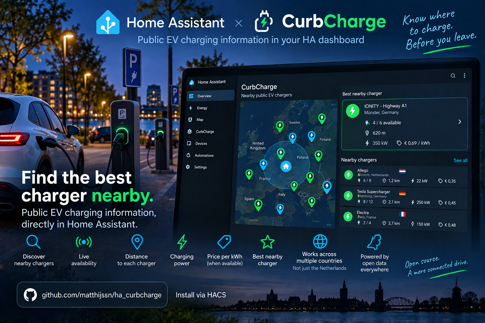
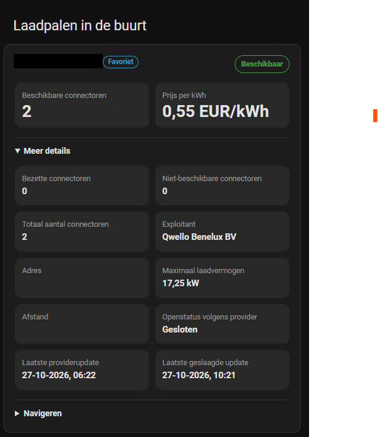

# CurbCharge

Stop guessing which nearby charger is actually free. CurbCharge finds public
EV charging points near your Home Assistant home, a manually set location, or
a tracked location entity. See provider-reported availability, connector
counts, power, distance and unambiguous tariff data, plus a recommendation for
the best nearby station. Favorites can be monitored with sensors and managed
with admin-only actions.

  

## Installation

### HACS

CurbCharge is in the HACS default store: open **HACS → Integrations**,
search for **CurbCharge**, and install it — or use the badge above to jump
straight there.

Restart Home Assistant, then add CurbCharge from **Settings → Devices &
services → Add integration**.

Use a Home Assistant release that meets the minimum listed in
[`hacs.json`](hacs.json).

### Manual

Copy `custom_components/curbcharge` into the Home Assistant configuration
directory at `custom_components/curbcharge`, then restart Home Assistant.

## Coverage

Provider availability depends on your installed release. Check the
[release notes](https://github.com/matthijssn/ha_curbcharge/releases) before
relying on a provider.

## What it provides

- Public charging coverage for the Netherlands, Belgium (preview), Norway,
  Sweden, the United States, Finland, Switzerland (preview), Luxembourg
  (Chargy network), and Lithuania — see
  [provider coverage and limitations](docs/usage.md#data-source-and-coverage)
  for data sources and preview status.
- One device per nearby public charging point, with site summaries when
  providers report a distinct location ID
- Provider-reported availability, connector counts, power, distance and operator
- Tariff information when the provider data is complete and unambiguous
- Recorder-facing availability and gross-price statistics, plus bounded
  Operator Insights summaries; see the [entity guide](docs/usage.md#entities)
- A best-nearby recommendation and favorite monitoring
- Optional connector, price, and operator personalization with match and
  fallback explanations
- A bundled dashboard card, plus copyable dashboard and automation examples

## Versioning and compatibility

Beginning with 1.0.0, patch and minor releases will preserve CurbCharge's
documented configuration, provider, device/entity, service, sensor-state, and
dashboard-card contracts. Breaking changes require a major version and
documented upgrade steps. See the [1.x compatibility contract](docs/development.md#1x-compatibility-contract).

## Documentation

- [User guide: coverage, setup, entities, updates, and privacy](docs/usage.md)
- [Dashboards, cards, and automations](docs/dashboards-and-automations.md)
- [Development and releases](docs/development.md)
- [Accessibility statement](ACCESSIBILITY.md)
- [Contributing](CONTRIBUTING.md) | [Code of Conduct](CODE_OF_CONDUCT.md) | [Security policy](SECURITY.md)
- [Copyable YAML examples](examples/)
- [Favorite services and automation guide](docs/dashboards-and-automations.md#favorite-services-and-automations)

## Community

Questions, ideas, or show-and-tell? Head to
[GitHub Discussions](https://github.com/matthijssn/ha_curbcharge/discussions).
Found a bug? [Open an issue](https://github.com/matthijssn/ha_curbcharge/issues) instead.

## Support

[Support CurbCharge on Ko-fi](https://ko-fi.com/matthijssn).
