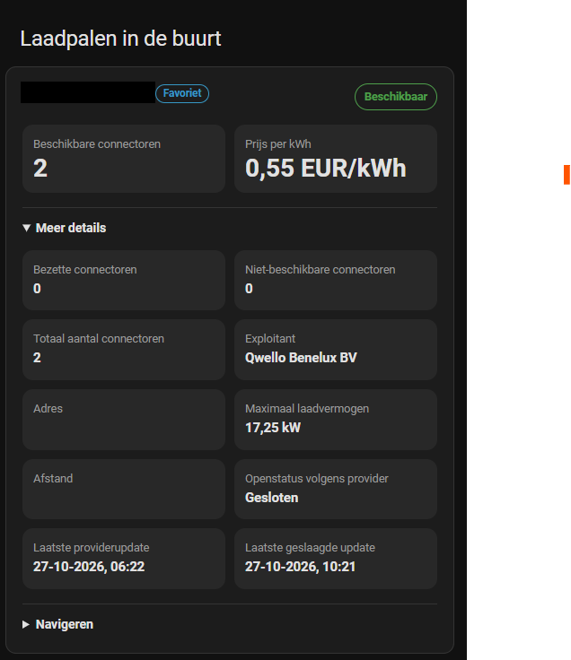

# CurbCharge

CurbCharge finds public EV charging points near your Home Assistant home, a
manually set location, or a tracked location entity. See provider-reported
availability, connector counts, power, distance and unambiguous tariff data,
plus a recommendation for the best nearby station. Favorites can be monitored
with sensors and managed with admin-only actions.

## Get started

Install **CurbCharge** from **HACS → Integrations**, then restart Home
Assistant and add CurbCharge from **Settings → Devices & services**.

Use a Home Assistant release that meets the minimum listed in
[`hacs.json`](hacs.json).

## Coverage

Provider availability depends on your installed release. Check the
[release notes](https://github.com/matthijssn/ha_curbcharge/releases) before
relying on a provider, and see
[provider coverage and limitations](docs/usage.md#data-source-and-coverage)
for data sources and preview status.

## Installation options

### HACS

In HACS, open **Integrations**, search for **CurbCharge**, and install it.
You can also [open CurbCharge in HACS](https://my.home-assistant.io/redirect/hacs_repository/?owner=matthijssn&repository=ha_curbcharge&category=integration).

Restart Home Assistant, then add CurbCharge from **Settings → Devices &
services → Add integration**.

### Manual

Copy `custom_components/curbcharge` into the Home Assistant configuration
directory at `custom_components/curbcharge`, then restart Home Assistant.

## What it provides

- One device per nearby public charging point
- Provider-reported availability, connector counts, power, distance and operator
- Tariff information when the provider data is complete and unambiguous
- A best-nearby recommendation and favorite monitoring
- A bundled dashboard card, plus copyable dashboard and automation examples

## Documentation

- [User guide: coverage, setup, entities, updates, and privacy](docs/usage.md)
- [Dashboards, cards, and automations](docs/dashboards-and-automations.md)
- [Development and releases](docs/development.md)
- [Contributing](CONTRIBUTING.md) | [Code of Conduct](CODE_OF_CONDUCT.md) | [Security policy](SECURITY.md)
- [Copyable YAML examples](examples/)
- [Favorite services and automation guide](docs/dashboards-and-automations.md#favorite-services-and-automations)

## Community

Questions, ideas, or show-and-tell? Head to
[GitHub Discussions](https://github.com/matthijssn/ha_curbcharge/discussions).
Found a bug? [Open an issue](https://github.com/matthijssn/ha_curbcharge/issues) instead.

## Support

[Support CurbCharge on Ko-fi](https://ko-fi.com/matthijssn).
