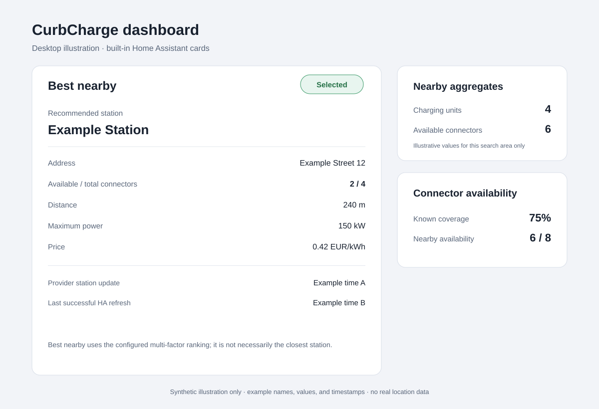
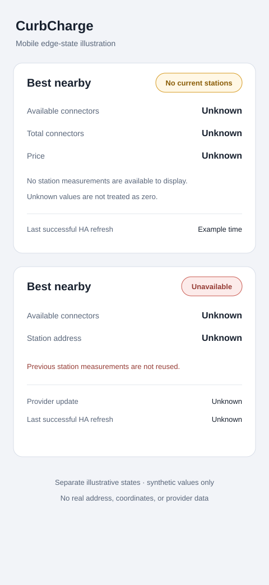

# Dashboards and automations

## Lovelace card

The CurbCharge card is bundled with the integration; it is not a separate HACS
plugin or a file that needs to be copied into `www`. The integration serves it
at `/curbcharge/curbcharge-card.js`. In **Settings → Dashboards → Resources**,
add that URL once as a JavaScript module. HACS updates the card with the
integration; reload or restart Home Assistant after updating.

Existing dashboards using `/local/curbcharge-card.js` only need a one-time
resource URL change to `/curbcharge/curbcharge-card.js`; the card configuration
does not need to change. After updating the resource, you can remove
`/config/www/curbcharge-card.js` if no other dashboard uses it. Future card
updates arrive with the integration. CurbCharge does not add a HACS frontend
item, dependency, or manifest setting for this bundled card.

### Native dashboard (no extra frontend cards)

A native dashboard can use Home Assistant's built-in Markdown and Entities
cards to show the integration-level **Best nearby** recommendation, station
details, and nearby aggregate sensors. The
[complete copyable YAML](../examples/curbcharge-dashboard.yaml) is ready to add
to a dashboard. Replace each `sensor.your_...` value with the corresponding
entity ID from your Home Assistant entity picker. Best nearby uses
CurbCharge's multi-factor ranking; it is not necessarily the closest station.
Use **Nearest available charger** when distance alone should determine the
selection.

### Native map and tap-to-navigate links

The built-in Map card can plot any entity with `latitude` and `longitude`
attributes. Per-station **Status summary** sensors already provide them;
**Best nearby** provides the selected destination coordinates. In the
[complete Map card example](../examples/curbcharge-map.yaml), replace both
example IDs with the entities from your instance, or remove the Status summary
row if it would duplicate the Best nearby marker. The card may also show Home
Assistant's Home zone; it is not used as a directions origin.

For one-tap links, use the built-in Markdown card template in
[`examples/curbcharge-navigation.yaml`](../examples/curbcharge-navigation.yaml).
It reads the selected entity's destination coordinates, using its address only
if coordinates are absent. Change the entity ID in both `entity_id` and the
template to use a per-station Status summary sensor instead.

Best nearby links appear only for a selected, available recommendation. A
Status summary with unknown connector availability can still provide directions
when it has valid coordinates or an address. No link is shown for a missing
destination or an unavailable/stale entity. The URLs omit route-origin
parameters, so they do not send Home Assistant's home, search-area, or vehicle
coordinates; a compatible map app can use the mobile device's current location.
The `geo:` link opens a map location only and is not turn-by-turn navigation.

These HTTPS links are opened only after the user taps them. App handoff depends
on the operating system, browser, Companion App, and installed map apps.
Google Maps and Waze may open their installed app or fall back to the provider
website. Apple Maps links use Apple's unified Maps URL format on supported
Apple operating systems; other devices may handle them differently. The
optional `geo:` URI works only when the operating system has a compatible map
handler. These are expected fallbacks, not guarantees for every device.

Before relying on the links, use the Home Assistant Companion App on Android
and iOS to tap each provider link with its app installed and absent, confirm the
fallback behavior, and check that directions start from the mobile device. Also
verify that the `geo:` link opens a location without claiming to start
navigation.

See the Home Assistant [Map card](https://www.home-assistant.io/dashboards/map/)
and [Markdown card](https://www.home-assistant.io/dashboards/markdown/)
documentation, plus the provider formats for
[Google Maps](https://developers.google.com/maps/documentation/urls/get-started),
[Apple Maps](https://developer.apple.com/documentation/mapkit/unified-map-urls),
and [Waze](https://developers.google.com/waze/deeplinks).

The native view has no custom-card dependency. If you prefer the bundled
CurbCharge card's summary layout, set its `entity` to a station **Status
summary** sensor, the Best nearby sensor, or the Top nearby chargers sensor:

```yaml
type: custom:curbcharge-card
entity: sensor.your_best_nearby_charger
```

To render the bounded Top N list instead, select its entry-level sensor:

```yaml
type: custom:curbcharge-card
entity: sensor.your_top_nearby_chargers
```

Existing YAML that sets only `entity` to a Status summary sensor remains
compatible. The card editor also offers standard or compact layout and controls
for price, connector details, station details, and update times. Secondary
details remain expandable and start collapsed. For YAML, the same options are
available:

```yaml
type: custom:curbcharge-card
entity: sensor.your_best_nearby_charger
layout: compact
show_price: true
show_connector_details: true
show_station_details: false
show_update_times: false
```

With only `entity` set, all metric groups are shown by default.
`show_price` controls price; `show_connector_details` controls occupied,
unavailable, and total counts; `show_station_details` controls address, maximum
power, distance, and provider-reported open status; `show_update_times` controls
provider and Home Assistant timestamps.

The card reads only the selected Home Assistant entity; it makes no provider
requests. It displays the station name and operator when available, address,
availability, connector counts, maximum power, distance, price/currency when
known, and update times. Labels follow the Home Assistant language in English,
Dutch, French, German, Norwegian Bokmål (`nb`), or Swedish (`sv`). Language is
independent of the selected provider country; station names and reported
currencies are preserved, and prices are not converted.
When configured with **Top nearby chargers**, it renders the backend-ordered
recommendations as one ordered list, including each station's rank, score,
ranking explanation, availability, and available price, power, and distance.
It does not sort the list or create per-result navigation links.
When the entity has a valid destination, a collapsed **Navigate** disclosure
offers explicit Google Maps, Apple Maps, Waze, and open-map links; nothing opens
until the user taps a link. It is hidden for an unavailable/stale entity or an
unselected Best nearby result. A Status summary with unknown availability can
still offer links when its destination is valid.

For recommendation sensors, `provider_last_updated` is the provider station
record time and `last_successful_update` is the last successful Home Assistant
refresh. Best nearby's legacy `last_updated` meaning is preserved and should
not be used as the provider timestamp. Its `result_status` distinguishes
`selected`, `no_current_stations`, `unknown_availability`, `none_available`,
and `unavailable`. Unknown values are not zero; when the entity is unavailable,
the bundled card does not show old measurements as current. The Status summary
and Best nearby also expose `provider_timestamp_source` and
`provider_data_age_seconds`; see [Data updates](usage.md#data-updates) for their
semantics.

### Norwegian Bokmål and Swedish release smoke check

Owner-run Home Assistant UI validation for `nb` and `sv` remains an outstanding
release gate tracked in [#257](https://github.com/matthijssn/ha_curbcharge/issues/257);
automated translation and card tests do not replace it. On a safe instance,
switch between both profile languages and inspect setup, options, both NOBIL
country/key prompts, entity/state/action labels, card details/navigation, and
the visual editor. Also check Norwegian-provider data in Swedish and
Swedish-provider data in Norwegian, including a language switch on an existing
card/editor without changing saved IDs or customized names.

Use safe positive, zero, unknown, and unavailable data, and inspect
`{connector_type}` substitution, accented characters, and longer labels. Record
the HA version, target release/commit and bundled-card version, locale,
surface/scenario, date, and pass/fail/blocked result with sanitized evidence in
the issue or release PR. Use mocks for rejected/replacement credentials; do not
trigger live authentication failures or quotas for this check.

### Optional: dynamic station list with Auto-Entities

Auto-Entities is a separate community frontend card. Install it separately
through HACS Frontend and register the JavaScript module resource specified by
its own installation instructions. This optional example is not required by
CurbCharge and is separate from the native dashboard above:

```yaml
type: custom:auto-entities
card:
  type: entities
  title: CurbCharge station summaries
filter:
  include:
    - entity_id: "sensor.*_status_summary"
sort:
  method: name
```

Adjust the filter to include only the stations or areas you want to list.

### Illustrations

These desktop and mobile mockups use synthetic values only; they are not live
Home Assistant captures and contain no real location data.





## Use cases and automations

### Charger recommendations

Add an **Entities** card and select **Nearest available charger**,
**Cheapest available charger**, **Fastest available charger**, and optionally
**Best nearby charger** in the Home Assistant card editor. The entity IDs are
specific to your config entry; for YAML dashboards, replace the example IDs
with the IDs shown in your Home Assistant entity picker:

```yaml
type: entities
title: Charger recommendations
entities:
  - entity: sensor.your_nearest_available_charger
  - entity: sensor.your_cheapest_available_charger
  - entity: sensor.your_fastest_available_charger
  - entity: sensor.your_best_nearby_charger
  - entity: sensor.your_top_nearby_chargers
```

The Top nearby state is the number of listed results; the ordered list and
candidate-relative scores are available as attributes. A template can read the
first recommendation without re-sorting it:

```jinja


  {{ recommendations[0]['name'] }} (rank {{ recommendations[0]['rank'] }}, score {{ recommendations[0]['score'] }}/100)

  No current recommendation ({{ states('sensor.your_top_nearby_chargers') }})

```

For example, this automation notifies when the top-ranked station or score
changes; it checks for a non-empty list so successful empty and unavailable
results are not treated as a charger:

```yaml
alias: Notify about the top nearby charger
trigger:
  - platform: state
    entity_id: sensor.your_top_nearby_chargers
condition:
  - condition: template
    value_template: >
      
      {{ recommendations | count > 0 }}
action:
  - service: notify.notify
    data:
      message: >
        
        
          
          {{ recommendation['name'] }} (rank {{ recommendation['rank'] }}, score {{ recommendation['score'] }}/100).
        
          No current recommendation is available.
        
mode: single
```

Automations can use the selected station name as the sensor state and read
distance, price, currency, power, or the selection reason from its attributes.
For example, notify when the cheapest available station changes:

```yaml
alias: Notify about the cheapest available charger
trigger:
  - platform: state
    entity_id: sensor.your_cheapest_available_charger
condition:
  - condition: template
    value_template: >
      {{ trigger.to_state is not none
         and trigger.to_state.state not in ['unknown', 'unavailable'] }}
action:
  - service: notify.notify
    data:
      title: Cheapest available charger
      message: >
        {{ trigger.to_state.state }} is
        {{ trigger.to_state.attributes.price_per_kwh }}
        {{ trigger.to_state.attributes.currency }} per kWh,
        {{ trigger.to_state.attributes.distance_m }} m away.
mode: single
```

The values are recalculated with the regular coordinator refresh, so an
automation responds to poll updates rather than every provider or GPS event.

### Favorite services and automations

Favorites belong to one CurbCharge config entry. The administrator-only
`curbcharge.add_favorite` and `curbcharge.remove_favorite` actions require
`config_entry_id` for a loaded CurbCharge entry and a provider-local
`station_id`; do not pass a Home Assistant entity ID as the station ID. In the
action UI, select the config entry and enter the provider station ID. In YAML,
replace the placeholders:

```yaml
sequence:
  - service: curbcharge.add_favorite
    data:
      config_entry_id: "YOUR_CONFIG_ENTRY_ID"
      station_id: "PROVIDER_LOCAL_STATION_ID"
```

Add accepts a station only when it was freshly discovered in that entry's last
successful nearby search; a duplicate add is a no-op. An invalid/unloaded entry
or a station that is not freshly discovered returns a visible validation
error. Remove also accepts a saved favorite that has become stale or is
confirmed missing:

```yaml
sequence:
  - service: curbcharge.remove_favorite
    data:
      config_entry_id: "YOUR_CONFIG_ENTRY_ID"
      station_id: "PROVIDER_LOCAL_STATION_ID"
```

A membership-only change updates the favorite sensors without an immediate
provider request; the next regular coordinator poll refreshes provider data.
The services do not call providers or notification actions.

Each saved favorite has a config-entry-scoped **Favorite status** sensor on
its station device. Its state is `available` only when a positive connector
count is known, `none_available` when the known count is zero, and `unknown`
when availability is not known. Stale provider data or a failed refresh makes
the entity `unavailable`; `is_stale`, `provider_update_success`, and
`missing_refresh_count` distinguish these cases. Numeric attributes include
`available_connectors`, `total_connectors`, `max_power_kw`, `price_per_kwh`,
`currency`, and `provider_data_age_seconds`.

The entry-level **Favorite summary** sensor has the configured favorite count
as its state. Its attributes report configured, discovered, known,
available, unknown, stale, and confirmed-missing favorite counts, plus
`last_successful_update`. `discovered_count` counts fresh provider results;
`known_count`, `available_count`, and `unknown_count` count favorite stations,
not connector units. A favorite becomes confirmed missing after three
consecutive successful omissions; failed refreshes do not increment that
count. The `nearest_available_favorite`, `cheapest_available_favorite`, and
`highest_power_available_favorite` attributes use the same station payload as
the other selection sensors. The cheapest result is empty when the available
favorites have mixed currencies; stale and unknown values are not treated as
zero.

Availability thresholds live in automations, not CurbCharge configuration.
For example, respond to either a known zero or unknown count becoming
positively available, while deliberately excluding recovery from an
unavailable provider:

```yaml
alias: Notify when a favorite becomes available
trigger:
  - platform: state
    entity_id: sensor.your_favorite_status
    from: "none_available"
    to: "available"
    id: known_zero
  - platform: state
    entity_id: sensor.your_favorite_status
    from: "unknown"
    to: "available"
    id: unknown_to_positive
action:
  - service: notify.notify
    data:
      message: >
        Favorite {{ state_attr(trigger.entity_id, 'provider_station_id') }}
        now reports
        {{ state_attr(trigger.entity_id, 'available_connectors') }}
        available connectors.
mode: single
```

Use numeric-state triggers on `available_connectors` for connector thresholds.
The conditions below ensure the reading is current and known:

```yaml
alias: Notify when a favorite has more than two connectors
trigger:
  - platform: numeric_state
    entity_id: sensor.your_favorite_status
    attribute: available_connectors
    above: 2
condition:
  - condition: template
    value_template: >
      {{ is_state('sensor.your_favorite_status', 'available')
         and state_attr('sensor.your_favorite_status', 'provider_update_success') is true
         and state_attr('sensor.your_favorite_status', 'is_stale') is false }}
action:
  - service: notify.notify
    data:
      message: "A favorite now reports more than two available connectors."
mode: single
```

For two or fewer connectors, use `below: 3`; this includes a known zero but
does not confuse unknown data with zero:

```yaml
alias: Notify when a favorite has two or fewer connectors
trigger:
  - platform: numeric_state
    entity_id: sensor.your_favorite_status
    attribute: available_connectors
    below: 3
condition:
  - condition: template
    value_template: >
      {{ states('sensor.your_favorite_status') in ['available', 'none_available']
         and state_attr('sensor.your_favorite_status', 'provider_update_success') is true
         and state_attr('sensor.your_favorite_status', 'is_stale') is false }}
action:
  - service: notify.notify
    data:
      message: "A favorite now reports two or fewer available connectors."
mode: single
```

Price automations should check the expected currency as well as the threshold.
For a EUR price below `0.30` per kWh:

```yaml
alias: Notify when a favorite drops below 0.30 EUR per kWh
trigger:
  - platform: numeric_state
    entity_id: sensor.your_favorite_status
    attribute: price_per_kwh
    below: 0.30
condition:
  - condition: template
    value_template: >
      {{ is_state('sensor.your_favorite_status', 'available')
         and state_attr('sensor.your_favorite_status', 'currency') == 'EUR'
         and state_attr('sensor.your_favorite_status', 'provider_update_success') is true
         and state_attr('sensor.your_favorite_status', 'is_stale') is false }}
action:
  - service: notify.notify
    data:
      message: >
        Favorite price is
        {{ state_attr('sensor.your_favorite_status', 'price_per_kwh') }} EUR/kWh.
mode: single
```

To report a confirmed missing favorite without treating a provider outage as
a miss, wait for the third successful omission and require both freshness
flags:

```yaml
alias: Notify when a favorite is confirmed missing
trigger:
  - platform: template
    value_template: >
      {{ is_state('sensor.your_favorite_status', 'unavailable')
         and state_attr('sensor.your_favorite_status', 'provider_update_success') is true
         and state_attr('sensor.your_favorite_status', 'is_stale') is true
         and state_attr('sensor.your_favorite_status', 'missing_refresh_count') == 3 }}
action:
  - service: notify.notify
    data:
      message: >
        Favorite
        {{ state_attr('sensor.your_favorite_status', 'provider_station_id') }}
        was missing in three successful refreshes.
mode: single
```

These snippets use `notify.notify` only as an example of a user-owned action;
replace it with a notification target configured in your Home Assistant.
CurbCharge never calls notification services. Favorites are uncapped; many
remote NDW favorites can add rate-limited lookups and lengthen a refresh. See
[Data updates](usage.md#data-updates) for provider timing details.

### Availability notifications

Import the [CurbCharge availability notification Blueprint](https://my.home-assistant.io/redirect/blueprint_import/?blueprint_url=https%3A%2F%2Fgithub.com%2Fmatthijssn%2Fha_curbcharge%2Fblob%2Fmain%2Fblueprints%2Fautomation%2Fcurbcharge%2Fnotify_when_charging_point_available.yaml)
into Home Assistant. Blueprint import is separate from installing CurbCharge
through HACS. Create an automation from the imported Blueprint, select one or
more station **Status summary** sensors, then choose your preferred Home
Assistant notification action.

The Blueprint triggers only on a known `none_available` → `available`
transition. Startup, `unknown`/`unavailable` recovery, and provider outages do
not count as a charger becoming available. You can require the station to
remain available for a minimum duration; this timer resets if Home Assistant
restarts or the automation reloads.

The optional provider-data-age check is off by default. If enabled, the
Blueprint reads the selected station's provider `last_updated` timestamp and
suppresses the action when it is missing, invalid, in the future, or older than
the configured maximum age. Provider timestamps can describe a record update,
not necessarily an availability change, and the data provider does not promise
a fixed maximum age. Set this guard to a threshold appropriate for your use;
it is not a guarantee that the station is currently available. Polling also
adds latency, so notifications are not real-time.

In your selected action, the Blueprint provides `station_name` and
`station_entity` variables. To create a simple manual automation instead,
listen for the same explicit Status summary transition:

```yaml
alias: Notify when a charging station is available
trigger:
  - platform: state
    entity_id: sensor.your_station_status_summary
    from: "none_available"
    to: "available"
action:
  - service: notify.notify
    data:
      title: Charging station available
      message: "{{ trigger.to_state.attributes.station_name }} now reports an available connector."
mode: single
```

### Reading observed availability transitions

For **Available**, `on` and `off` are known provider reports. `unknown` means
the latest snapshot has no usable availability; `unavailable` means the entity
cannot currently report, for example because its station is stale or a
coordinator refresh failed. Neither is an `off` state. A missed station becomes
unavailable after a successful poll; non-favourites are removed after three
consecutive successful misses, while favourites remain unavailable. Failed
refreshes do not count as misses.

To inspect how long the current state has been known, paste this guarded
template into **Developer tools > Template**. It returns seconds only for a
current `on` or `off` state:

```jinja



  
  {{ (as_timestamp(now()) - as_timestamp(state.last_changed)) | int }}

  No known availability state

```

`last_changed` is the time Home Assistant observed that transition, not the
provider's actual transition time. CurbCharge does not restore a station's
prior live state after a Home Assistant restart or config-entry reload; a fresh
snapshot establishes the current state, so this duration does not span a
restart. Earlier transitions may still be visible in Recorder-backed History
while they remain within its retention.

In an automation, `trigger.from_state` and `trigger.to_state` are the state
objects on either side of the trigger. Guard against missing or non-binary
states so startup, recovery from a gap, and attribute-only updates are not
reported as known availability transitions:

```yaml
alias: Notify about an observed availability transition
trigger:
  - platform: state
    entity_id: binary_sensor.your_station_available
condition:
  - condition: template
    value_template: >
      {{ trigger.from_state is not none
         and trigger.to_state is not none
         and trigger.from_state.state in ['on', 'off']
         and trigger.to_state.state in ['on', 'off']
         and trigger.from_state.state != trigger.to_state.state }}
action:
  - service: notify.notify
    data:
      title: Station availability changed
      message: >
        Home Assistant observed {{ trigger.from_state.state }} to
        {{ trigger.to_state.state }} at {{ trigger.to_state.last_changed }}.
mode: single
```

The trigger timestamp is Home Assistant's observation time. This example reads
built-in state objects only; it does not create a timestamp entity or save a
separate transition history.

### Historical availability and connector counts

The **Available** binary sensor gives a per-station `on`/`off` timeline from
provider snapshots. The **Availability percentage** sensor is the current
snapshot expressed as `100%`, `0%`, or unknown; it does not calculate the
percentage of time a charger was available. The nearby connector percentage is
a separate, search-area aggregate weighted by known connector counts.

To calculate how long a station was reported available, create Home Assistant's
built-in [History Stats](https://www.home-assistant.io/integrations/history_stats/)
helper for its **Available** binary sensor. Choose `time` for hours in the
selected period or `ratio` for the portion of that period spent in `on`.
For example, this YAML configuration creates a daily ratio:

```yaml
sensor:
  - platform: history_stats
    name: Station available today
    entity_id: binary_sensor.your_station_available
    state: "on"
    type: ratio
    start: "{{ today_at() }}"
    end: "{{ now() }}"
```

The helper uses Home Assistant's [History](https://www.home-assistant.io/integrations/history/)
data, which is stored by [Recorder](https://www.home-assistant.io/integrations/recorder/),
and is limited by its retention. Unknown provider availability appears as
unknown, while stale station data or a coordinator failure can make the
entities unavailable. These are gaps, not confirmation that the station was
unavailable; review the source timeline before interpreting a ratio as complete
uptime.

Use a [History Graph](https://www.home-assistant.io/dashboards/history-graph/)
for recent state changes and connector counts:

```yaml
type: history-graph
title: Station availability and connector counts
hours_to_show: 24
entities:
  - binary_sensor.your_station_available
  - sensor.your_station_available_connectors
  - sensor.your_station_total_connectors
```

For longer-term hourly trends, use Home Assistant's
[Statistics Graph](https://www.home-assistant.io/dashboards/statistics-graph/)
with the per-station percentage sensor:

```yaml
type: statistics-graph
title: Station availability, hourly
days_to_show: 30
period: hour
chart_type: line
stat_types:
  - mean
entities:
  - sensor.your_station_availability_percentage
```

Connector counts have different units, so graph them in a separate card:

```yaml
type: statistics-graph
title: Connector counts, hourly
days_to_show: 30
period: hour
chart_type: line
stat_types:
  - mean
entities:
  - sensor.your_station_available_connectors
  - sensor.your_station_total_connectors
```

Home Assistant's [Recorder](https://www.home-assistant.io/integrations/recorder/)
keeps detailed state history for 10 days by default (`purge_keep_days`); this
can be changed in the Home Assistant Recorder configuration. Five-minute
statistics follow that retention, while hourly
long-term statistics for measurement sensors such as availability percentage
and connector counts are retained indefinitely. The hourly mean of the
percentage sensor is a trend of reported `0%`/`100%` values, not an exact
time-in-state calculation; it cannot show changes between provider polls.
For numeric sensors with long-term statistics, History Graph may use hourly
aggregates for older portions of its range; binary sensor transitions remain
limited to retained detailed history.

Recorder storage is managed by Home Assistant. Each enabled station entity
included in Recorder adds history and eligible statistics, so following more
stations increases database use. Choose Recorder retention and exclusions to
suit your instance; long-term statistics persist until removed or the database
is cleared. Replace the example entity IDs above with the IDs shown in your
Home Assistant entity picker.
