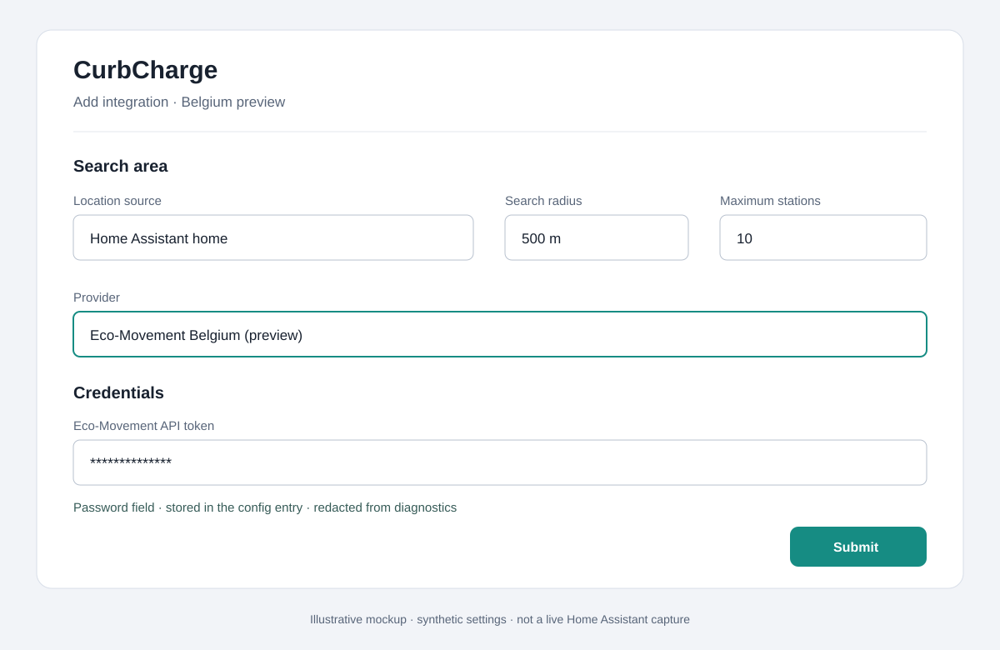
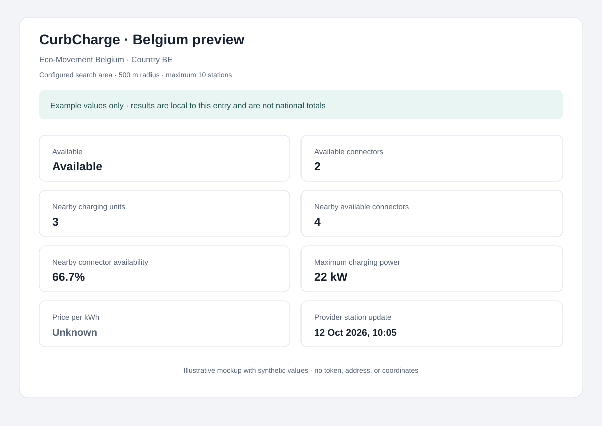

# User guide

## Data source and coverage

The first provider is the Dutch [NDW DOT-NL platform][dotnl], which publishes
data about publicly accessible charging points in the Netherlands. CurbCharge
uses its documented [GeoJSON consumer API][geojson-api] for locations and
availability and its [OCPI tariff data file][tariffs] for tariff components.
Data is provided by charging point operators and made available by NDW on
behalf of the Dutch Ministry of Infrastructure and Water Management. The API
consumer documentation currently warns that its specifications may change.

The GeoJSON endpoint includes a provider `last_updated` value for each point.
Availability is therefore the latest snapshot NDW supplies, not a guaranteed
real-time feed; freshness can differ by operator. The integration exposes the
station's update timestamp and does not invent missing status or price data.
DOT-NL does not supply a station name in this response, so CurbCharge uses its
address as the display name and falls back to the provider station ID if the
address is empty.

DOT-NL reports availability as counts grouped by connector characteristics.
It does not identify individual connectors or distinguish occupied, reserved,
out-of-service, and other unavailable connectors. CurbCharge reports the
available and total counts exactly, derives the count not reported available,
and leaves occupied status unknown when the source cannot establish it. The
provider-reported `open` status is displayed separately; CurbCharge does not
infer connector availability from it or vice versa.

Tariffs are shown only when every connector group at a station resolves to the
same active currency and price components. Date-only OCPI restrictions are
evaluated using the Netherlands local date; session-dependent or time-window
restrictions remain unknown. Conflicting, missing, incomplete, or mixed-currency tariffs also
remain unknown rather than being guessed or shown as zero. The price and
status-summary sensors expose tariff attributes, including a stable
`tariff_status` (`available`, `not_reported`, `missing`, `conditional`,
`inactive`, `incomplete`, or `ambiguous`). When no single station-wide price
is available, the status-summary sensor includes a connector-group tariff
breakdown. OCPI price components are published before VAT; CurbCharge applies
the reported VAT percentage to present a gross rate and treats a missing VAT
rate as unknown.

The GeoJSON OpenAPI description labels `power_max` as kW, while current live
examples contain values such as `15000` for a 15 kW connector. CurbCharge
normalizes values above 1000 as watts; values at or below 1000 are treated as
kW. This follows the observed feed while accommodating the published unit
description.

### Belgium DATEX II (preview)

The Belgium adapter targets Eco-Movement's [DATEX II API][belgium-datex-api],
and can be selected in the config flow. Setup asks for an Eco-Movement API
token as a password field, validates it before creating the entry, stores it
only in config-entry data, and redacts it from diagnostics. Use this preview
only if you are authorized to access the API and have reviewed the applicable
terms. Eco-Movement issues these tokens; request access by emailing
[Eco-Movement support](mailto:support@eco-movement.com).

The `/locations` snapshot refreshes every 24 hours. Eco-Movement documents
status updates on change and within one minute, but CurbCharge reads them on
its scheduled polls; the default interval is five minutes and quotas may add
further delay. The limits are one request per 10 seconds per source IP, 30
location requests per hour per token, and two status requests per minute per
EVSE per token. The provider uses a shared Home Assistant request limiter; a
refresh can therefore take several minutes when many EVSEs need status updates.
A `Retry-After` response pauses requests from all Belgium entries sharing that
limiter. If a token expires or is revoked, the integration prompts for a
replacement token and validates it before updating the entry.

Eco-Movement access approval, applicable terms/licensing, and live Belgian
payload compatibility have not been verified. Treat them as release blockers.
Tests use sanitized synthetic examples based on the published DATEX profile;
no recorded production response is committed.
Missing status remains unknown; failed updates make coordinator entities
unavailable instead of inferring charger state. See the
[Transportdata.be dataset][belgium-dataset].

## Configuration

Add **CurbCharge** from **Settings → Devices & services → Add integration**.
Choose one of three location sources:

- **Home** uses Home Assistant's configured home coordinates when the
  integration sets up; they are not copied into the config entry.
- **Manual** uses the latitude and longitude you enter. These fixed coordinates
  are stored locally because they are needed for each search.
- **Entity** uses a generic Home Assistant entity selector. Select any entity
  that currently exposes valid numeric `latitude` and `longitude` attributes;
  it is not restricted to the `device_tracker` domain. CurbCharge stores the
  selected entity ID locally and resolves its coordinates at runtime, without
  persisting the changing coordinates.

Use **Reconfigure** on an existing entry to change its location source or to
select a replacement if an Entity source was renamed or removed.

Choose a polling interval in minutes (default 5; minimum 1), a search radius
from 100 to 10,000 metres, and a maximum of 1 to 50 stations (default 10), then
select NDW DOT-NL or the Belgium preview. Belgium setup also asks for the
Eco-Movement API token and validates connectivity before creating the entry.
You can change the polling interval, radius, station limit, and whether to
include stations without availability data later in Options. For Entity
sources, Options also offers a movement threshold that defaults to 100 metres;
set it to `0` to disable the threshold. Favourites can also be selected by
their displayed names. They are stored per config entry, continue to be
refreshed outside the search radius, and are added beyond the normal nearby
station limit. The provider is selected during setup and cannot be switched
from Options.
For NDW DOT-NL, an additional setup step and the Options flow offer connector
type, minimum power, and require-available filters. Select zero or more
connector types; if several are selected, any one may match, but the same
connector group must also meet the selected power and availability criteria.
For example, **Type 2 (Mennekes)** with a minimum of `11` kW accepts a Type 2
group reporting at least `11` kW; **CCS (Combo 2)** with a minimum of `100` kW
accepts a matching CCS group reporting at least `100` kW. The thresholds are
inclusive. **Require an available connector** additionally requires that same
group to report a positive available count.

Leave connector types empty and minimum power blank to omit those filters;
minimum power must be finite and positive. Require-available is off by default.
Missing or unknown group data does not satisfy an active filter. The existing
**Include stations without availability data** option is separate and enabled
by default; turning it off excludes NDW stations with no availability report
before the station cap. The search radius remains the distance limit, and the
maximum-station cap selects the nearest matching stations (with provider
station ID as the tie-breaker). These filters are NDW-only; Belgium preview
has no discovery-filter step or options. There is no provider-side operator
discovery filter or separate maximum-distance setting.

The separate **Personalization** options page stores one optional, versioned
profile in the config entry's Options. It is disabled by default and supports
canonical connector types, minimum connector-group power, preferred and
excluded operators, an optional maximum price and currency, a fixed ranking
preset, fallback, and an unknown-data policy. A maximum price must be a
nonnegative decimal and include a three-letter currency code.

Enter operator references one per line as `ndw_dot_nl:<cpo_id>` or
`eco_movement_be:<operator name>`. NDW's `cpo_id` identifies the CPO in its
published data; see the
[NDW OCPI data-submission documentation](https://docs.ndw.nu/en/data-uitwisseling/interface-beschrijvingen/dafne-api/dafne_api_supplier/).
It is used as a provider-scoped key, not a promise that an operator identifier
can never change; if it changes, the saved preference remains stored but no
longer matches.
Belgium currently has no stable operator ID in the available fixture, so its
names match only after trimming, collapsing whitespace, and case-folding.
These references are saved independently of the current search radius and are
not fuzzy-matched. The profile is stored for personalization support; existing
recommendation behavior remains unchanged until a recommendation evaluator
consumes it. Older entries without a profile remain disabled without a config
entry migration.

See the
[Belgium preview setup](#belgium-preview-setup) steps before choosing that
provider.

### Belgium preview setup

1. Request an authorized token from [Eco-Movement support](mailto:support@eco-movement.com)
   before setup. CurbCharge cannot issue a token; see the official
   [DATEX II API documentation][belgium-datex-api] for access and terms.
2. Add CurbCharge from **Settings → Devices & services → Add integration**.
   Choose Home Assistant's home location, enter a manual location, or select
   an entity with valid coordinates, then set the search radius and maximum
   station count.
3. Select **Eco-Movement Belgium**. On the next step, paste the token into the
   password field; CurbCharge validates it before creating the config entry.
4. Keep the token private. It is stored in the config entry and redacted from
   diagnostics; never include it in screenshots, logs, or issue reports. If
   the token expires or is revoked, Home Assistant starts reauthentication so
   you can enter a replacement.

The following original mockups use synthetic values; they are illustrative
examples, not captures of a live Home Assistant session.





## Supported stations

CurbCharge's supported live coverage is public charging points in the
Netherlands published by NDW DOT-NL. Belgium DATEX II is available as a preview
for authorized users, but is not considered release-ready until access,
licensing, quotas, and real-payload compatibility are verified. CurbCharge
reports provider data; it does not connect to or control physical chargers.
An Entity location moves the search center but does not extend provider
coverage. Each poll still applies the selected provider's geographic coverage,
configured search radius, and station limit.

## Entities

Each charging point is one Home Assistant device. CurbCharge creates:

- **Available**: on when the provider reports at least one available connector.
- **Availability percentage**: `100%` when **Available** is on, `0%` when the
  provider reports no available connectors, and unknown when availability is
  unknown. It mirrors the binary sensor; it is not a percentage of time
  available or a ratio of available to total connectors.
- **Available connectors**, **Occupied connectors**, **Unavailable
  connectors**, and **Total connectors**.
- **Maximum charging power**, **Price per kWh**, and **Distance**.
- **Status summary**, including connector types, operator, address, provider
  status, tariff details, coordinates, provider timestamp provenance, and
  provider-record age when known.
- The Status summary's `is_favorite` attribute identifies stations selected
  as favourites for this config entry.
- One **Favorite status** sensor is created for each saved favourite and
  attached to its station device. Its state is `available` only for a known
  positive connector count, `none_available` for known zero, and `unknown` when
  availability is unknown. Stale station data and failed coordinator refreshes
  make it `unavailable`; attributes distinguish `is_stale`,
  `provider_update_success`, and `missing_refresh_count`. Numeric attributes
  expose available/total connectors, maximum power, price/currency, and
  provider-data freshness for automation triggers.
- The entry-level **Favorite summary** state is the configured favourite
  count. Its attributes report configured, discovered, known, available,
  unknown, stale, and confirmed-missing favourite counts, the last successful
  update, and nearest, cheapest, and highest-power available-favourite
  recommendations. Each recommendation uses the shared station payload; the
  cheapest result is empty when prices span multiple currencies.
- Integration-level **Best nearby charger**, **Top nearby chargers**,
  **Nearest available charger**, **Cheapest available charger**,
  **Fastest available charger**, **Nearby charging units**, and **Nearby
  available connectors** sensors. The
  charging-unit count covers
  current, non-stale records in that entry's configured search area (NDW
  charge-point records in the Netherlands and EVSEs in Belgium), not physical
  sites, available chargers, or nationwide coverage. Its attributes report
  unknown availability and stale records, provider, search radius, result cap,
  and whether results may be truncated.
- The available-connectors count sums only connector counts explicitly reported
  as available at current stations. It exposes known, unknown, and stale
  station counts; missing fresh availability is unknown, not zero. A Belgian
  EVSE's overall available status does not imply that its connector count is
  known.
- **Nearby connector availability** is the weighted percentage of known
  available connectors over the corresponding known total counts, rounded to
  one decimal place; it is a ratio of summed counts, not an average of station
  percentages. Connector groups with unknown availability and stale stations
  are excluded. Coverage is the known denominator over all fresh,
  provider-reported connector totals; attributes also disclose unreported
  totals. If no known denominator remains, the sensor is unknown rather than
  0%.

The Home Assistant State object has its own `last_changed` and `last_updated`
timestamps. `last_changed` is when Home Assistant last observed the entity's
state value change; it changes only when the state changes. `last_updated`
changes when the state or its attributes change. For **Available**, while the
state is `on`, `last_changed` marks the last observed transition to available;
while it is `off`, it marks the last observed transition to no available
connectors. It records only the current state's last change, not separate
timestamps for the last transition in each direction. See Home Assistant's
[State and state object documentation](https://www.home-assistant.io/docs/configuration/state_object/).

These statistics are scoped to one config entry's bounded search area.
Separate entries, including overlapping searches in the same country, remain
separate and must not be summed as national coverage.

Favourites remain represented as devices when they are outside the configured
radius or the normal result cap. Nearby aggregate sensors remain radius-scoped:
they include fresh in-radius favourites but exclude remote favourites. Best
nearby gives no favourite bonus; fresh in-radius favourites compete under the
normal ranking, while remote or stale favourites are excluded.

For each availability group reported by NDW, the station also has a
disabled-by-default connector-group sensor. The provider groups connectors by type and
power characteristics; these are not individual physical connector IDs.

The occupied sensor is unknown if the provider only reports available and
total counts and some connectors are not available. This avoids treating a
reserved or out-of-service connector as occupied. The unavailable count is
`total - available`, which is the only additional count directly supported by
the NDW availability response.

**Best nearby** keeps its existing ranking: lower known prices when all
candidate prices use the same currency, then shorter distance, more available
connectors, higher power, and a stable station identifier. Its `reason`
attribute is a stable reason code.

The three additional selectors offer deterministic alternatives. Each requires
a fresh station with a known `available_connectors` count greater than zero;
unknown availability, zero connectors, and stale records do not qualify.
**Nearest available charger** requires a known distance and chooses the
shortest. **Cheapest available charger** ignores unpriced stations, compares
only unambiguous station-level prices in one currency, and returns no station
if no price is known or known prices use multiple currencies. Its tie-breaks
are shorter distance, more available connectors, higher power, then stable
provider/station identity. **Fastest available charger** chooses the highest
positive station-level `max_power_kw`, then shorter distance and more
available connectors. It uses a lower known price only when powered
candidates' prices are comparable in one currency; missing prices sort after
known prices, and mixed currencies skip this tie-break. Stable identity breaks
any remaining tie. Fastest power is the highest reported connector-group
power, not a claim about the currently available physical plug.

The Best nearby and alternative selector sensors expose the selected station's
`best_nearby_rank`, `best_nearby_rank_score`, and
`best_nearby_candidate_count`. The Status summary sensor exposes the same
attributes for each station in the Best nearby ranking. The eligible cohort is
fresh, in-radius stations with known positive availability; a Belgium
status-only station may qualify even when its connector count is unknown. For
`N` candidates, the one-based rank score is `100 * (N - rank + 1) / N`.
Scores are relative to the current cohort, not an absolute station-quality or
confidence measure; rank one scores 100, and an empty cohort has no rank or
score and a candidate count of zero. After a failed refresh, recommendation
snapshots are not presented as current, and rank, score, and candidate count
are unknown. Existing station attributes such as
`price_per_kwh`, `currency`, `distance_m`, `available_connectors`,
`max_power_kw`, `provider`, and `provider_station_id` show the comparison
inputs; unknown inputs stay null, not zero. Provider data age is not a scoring
input. These sensors use cached coordinator results and make no extra provider
requests.

The **Top nearby chargers** sensor uses that same backend ranking and returns
at most five stations, independent of the nearby-station limit. Its state is
the number of returned items; its `recommendations` attribute is `[]` after a
successful empty update and `null` after a failed update. Each item includes
the shared selected-station payload plus one-based `rank`, candidate-relative
`score`, `score_components` (`price_per_kwh`, `currency`, `distance_m`,
`available_connectors`, and `max_power_kw`), the stable `reason` code
`best_nearby_rank`, and the overall `ranking_reason`. The component values
remain null when unknown. `best_nearby_candidate_count` reports the full
eligible cohort even when more than five stations are available. No per-rank
entities, separate recommendation history, or provider requests are created;
Home Assistant Recorder may still retain the sensor's normal state and
attribute history according to its own settings.

Best nearby, Top nearby, and alternative selection sensors expose
`result_status` values such as `selected`, `unavailable`,
`no_current_stations`, `unknown_availability`, and `none_available`.
Cheapest can also report `no_comparable_price` when no known price exists or
prices use multiple currencies; Fastest reports `no_positive_power` when no
eligible station has a finite positive power; Nearest reports
`no_known_distance` when no eligible station has a known distance.

When a tracked search center moves, newly matching stations are added on the
next successful refresh. A non-favourite station absent from three consecutive
successful refreshes becomes unavailable after the first miss and its entities
and device are removed after the third. A station omitted because it no longer
matches an NDW filter follows the same lifecycle; if it matches again before
the third successful omission, its existing device and entity IDs are reused.
Saved favourites remain as unavailable devices through provider misses;
removing a favourite resumes the three-refresh removal behavior. Provider
failures and invalid location updates do not count as station absences or
replace the last successful coordinator data.

## Data updates

CurbCharge refreshes station data with a shared `DataUpdateCoordinator`. The
coordinator calls the provider once per cycle; entities never make requests.
Each config entry polls at its selected scan interval (five minutes by
default, at least one minute). This is separate from the per-request throttle:
NDW documents a maximum of 10 GeoJSON requests per second, and CurbCharge's
shared limiter spaces requests and honors `Retry-After` responses. NDW may
paginate GeoJSON results, and tariffs come from a separate OCPI file cached
for six hours. The provider client may therefore make additional HTTP requests
when more pages or uncached tariffs are needed.
NDW discovery filters run locally on the normalized, radius-bounded results
from the regular bounding-box refresh. They do not add provider requests;
matching candidates are sorted and capped before tariff lookup.
On the Status summary, `last_updated` is the provider record timestamp; on Best
nearby, `provider_last_updated` is the provider record timestamp and the legacy
`last_updated` remains the Home Assistant poll time. For both, `last_successful_update`
is when the coordinator last completed a successful refresh. Provider
timestamps describe their source record, not necessarily an availability
change, and may be older than the latest poll. The coordinator timestamp does
not advance on failed refreshes; station entities then become `unavailable`,
not `off`. These attributes are distinct from the Home Assistant State object's
`last_changed` and `last_updated` timestamps described above.

`provider_timestamp_source` identifies the timestamp as an NDW feature time,
a Belgium EVSE status time, or a Belgium static fallback. The derived
`provider_data_age_seconds` is the whole-second age of a dynamic provider
record, calculated in UTC when coordinator-backed attributes are written; it
does not tick between polls. A missing or future timestamp, or a Belgium
static fallback timestamp, yields unknown age (`None`). A missing NDW
timestamp does not invalidate otherwise usable availability data. Malformed
or timezone-naive provider timestamps are rejected as provider errors.

The NDW source does not document a maximum update interval for an individual
station, so an unchanged timestamp can be legitimate. CurbCharge applies no
age cutoff and does not treat any age as a guarantee of current availability.
The age attribute itself does not change reported availability, Best nearby
ranking, notifications, or the coordinator's stale/unavailable behavior; only
an explicitly configured user template or Blueprint condition can use an
age limit. For Home Assistant-observed availability transitions and Recorder
history, see [Reading observed availability transitions](dashboards-and-automations.md#reading-observed-availability-transitions)
and [Historical availability and connector counts](dashboards-and-automations.md#historical-availability-and-connector-counts).

For example, a native template condition can apply a user-chosen limit:

```yaml
condition:
  - condition: template
    value_template: >
      
      {{ age is not none and age < 900 }}
```

Replace the entity ID and choose a threshold appropriate for your use; `900`
seconds (15 minutes) is illustrative only, not a CurbCharge freshness
guarantee.

These timestamps are distinct from the Home Assistant State object's
`last_changed` and `last_updated` timestamps described above. CurbCharge
reports provider data at its polling cadence; Home Assistant history records
entity state changes, so a change between polls cannot appear in the
integration's history.
Favourites outside the normal NDW search results use additional small
bounding-box requests; the provider client spaces these requests to respect
its rate limit. Belgium favourites use the cached location snapshot and status
requests through the shared limiter. There is no favourite-count cap, so a
large list of remote NDW favourites can lengthen a refresh under the shared
provider limiter.

For an Entity source, CurbCharge samples coordinates during the normal
coordinator refreshes. It does not subscribe to every entity state change or
make a provider request for each GPS update. The movement threshold compares
each valid coordinate with the last accepted search center: smaller fixes
accumulate relative to that center, so GPS jitter below the threshold does not
move the search. With a threshold of `0`, any changed coordinates are accepted
at the next poll. Availability polling continues at its configured cadence
whether or not the center moves. A move can take up to one polling interval,
plus provider latency or rate-limit delays, to affect results; this is not
real-time tracking.

If the selected entity is unavailable or has invalid coordinates at a poll,
CurbCharge skips the provider request, retains its last successful data, and
marks station entities unavailable. It tries again on the next refresh;
updates resume when valid coordinates return.

## Services

`curbcharge.add_favorite` and `curbcharge.remove_favorite` are administrator-only
actions. Both require `config_entry_id` for a loaded CurbCharge entry and a
provider-local `station_id`; this is not a Home Assistant entity ID. Add accepts
only a freshly discovered station from the entry's latest successful nearby
search, and adding an existing favourite is an idempotent no-op. Remove works
for saved favourites even when stale or confirmed missing. Unknown IDs,
unloaded/wrong entries, and invalid calls produce visible validation errors.

Favourite membership is persisted in that config entry's options. A
membership-only change updates the favourite sensors without an immediate
provider request; normal coordinator polling supplies future provider data.
CurbCharge does not call notification services or provide device triggers or
conditions. Notification actions in the Blueprint and automation examples are
chosen by the user. See the
[favorite services and automation examples](dashboards-and-automations.md#favorite-services-and-automations).

## Troubleshooting

- **No stations appear:** Check the configured location source, radius,
  and that the selected provider has coverage for that area.
- **Entity location is unavailable:** Check that the selected entity still
  exists and currently reports valid latitude and longitude attributes. An
  unavailable or invalid source skips provider requests until a later poll
  finds valid coordinates. If the entity was renamed or removed, use
  **Reconfigure** to select its replacement.
- **Setup cannot connect:** Check Home Assistant internet access and retry
  after a provider rate limit expires.
- **Belgium token rejected:** Confirm Eco-Movement issued the token for your
  account and that it has not expired or been revoked. Use the reauthentication
  flow for a replacement; do not include the token in a support request.
- **Belgium requests are rate limited:** Wait for the provider's `Retry-After`
  interval. All Belgium entries on the same Home Assistant host share the
  per-IP limiter; see the documented per-token limits above.
- **Belgium availability is unknown:** Static location data refreshes daily and
  dynamic status is requested per EVSE. A location can exist without a current
  status report; CurbCharge leaves that availability unknown.
- **NDW availability is unknown:** NDW may not have supplied connector availability
  for that station. CurbCharge does not infer it from operational status.
- **Price is unknown:** The provider may omit the tariff or publish conditional,
  conflicting, mixed-currency, or incomplete tax data.
- **Data looks old:** Compare the station's provider update timestamp with
  Home Assistant's last successful refresh timestamp.
- **Favorite action validation failed:** Select a loaded CurbCharge entry and
  use the provider-local station ID, not an entity ID. Add requires a station
  from the latest successful nearby search; remove accepts a saved station
  that has since gone stale or missing.
- **A station disappeared:** Temporarily missing stations remain unavailable
  for two successful polls and are removed after the third. Saved favourites
  remain unavailable until returned or unfavourited.

## Privacy and diagnostics

Diagnostics omit station addresses and exact station coordinates, redact
manual coordinates, Entity source IDs, and saved favourite references from
entry data, and round distances to the nearest kilometre. In Entity mode, the
selected entity ID is stored locally in the config entry and redacted from
diagnostics; its changing coordinates are not persisted or included in
diagnostics. Favourite membership is stored by provider and station ID; current
display names and addresses are not persisted. Saved coordinates are only
lookup hints for NDW's spatial API and are redacted from diagnostics. The
diagnostics `favourite_references` section reports a per-entry SHA-256 hash
derived from the config-entry ID, provider, and station ID, plus presence and
missing-refresh information; it does not expose the raw station ID. Favourite
IDs and lookup hints are not included in the diagnostic station list.
CurbCharge does not log entity IDs, coordinates,
credentials, or raw provider responses. The integration does not request
credentials from NDW. History and statistics are Home Assistant Recorder data
and follow its database, retention, and exclusion settings; CurbCharge does
not create a separate history database, change Recorder settings, or send
recorded history to a provider. It does not predict availability or use AI. To
download diagnostics, open **Settings → Devices & services → CurbCharge**, open
the integration menu, and select **Download diagnostics**.

## Removing CurbCharge

Remove the integration from **Settings → Devices & services**; this also
removes its stored Belgium token. For a manual installation, delete
`custom_components/curbcharge` from the Home Assistant configuration directory
and restart Home Assistant.

[dotnl]: https://english.ndw.nu/dataportals/dot-nl
[geojson-api]: https://docs.ndw.nu/data-uitwisseling/interface-beschrijvingen/dafne-api/dafne_api_consumer_pull/
[tariffs]: https://opendata.ndw.nu/charging_point_tariffs_ocpi.json.gz
[belgium-datex-api]: https://developers.eco-movement.com/docs/belgium-datex-ii-api
[belgium-dataset]: https://transportdata.be/en/dataset/public-charging-infrastructure-static-dataset-selected-cpos-datex-ii
